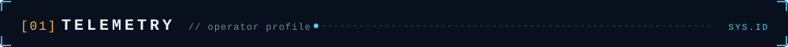
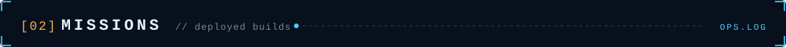
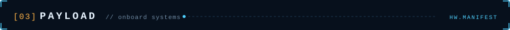
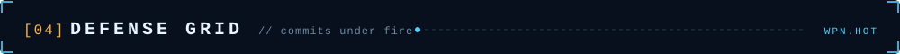
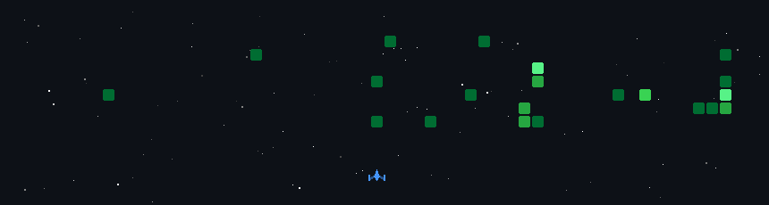

<p align="center">
  
</p>

<p align="center">
  <a href="https://linkedin.com/in/tejas-kumat-6756b7331"></a>
  <a href="mailto:kumattejas375@gmail.com"></a>
  
</p>

<p align="center">
  <br/>
  <sub><code>⚠ your visit has been logged by ground control. you are now a data point. welcome aboard.</code></sub>
</p>



```yaml
operator:  Tejas Kumat
class:     CS undergrad · backend & AI engineer
base:      Bengaluru, IN
core:      [Python, FastAPI, PostgreSQL, React, Docker, Kubernetes]
training:  [LangGraph, MCP, distributed systems]
doctrine:  "Read the docs. Write the test. Ship it."
status:    ONLINE
```



<p align="center">
  <a href="https://github.com/TejasKumat8/RepoVerse"></a>
  <a href="https://github.com/TejasKumat8/clinicpulse-devops-capstone"></a>
  <a href="https://github.com/TejasKumat8/searchiq"></a>
  <a href="https://github.com/TejasKumat8/multithreaded-http-server"></a>
</p>



<table align="center">
  <tr>
    <td align="center"><code>PROPULSION</code><br/><sub>languages</sub><br/><br/></td>
    <td align="center"><code>CORE SYSTEMS</code><br/><sub>backend &amp; data</sub><br/><br/></td>
  </tr>
  <tr>
    <td align="center"><code>HUD</code><br/><sub>frontend</sub><br/><br/></td>
    <td align="center"><code>LAUNCH INFRA</code><br/><sub>devops &amp; cloud</sub><br/><br/></td>
  </tr>
</table>



<p align="center">
  
</p>

<p align="center">
  <sub><code>INCIDENT REPORT: operator keeps shooting down their own commits. asked to stop. response: "relax, I'll just push more."</code></sub>
</p>


