<p align="center">
  
</p>

<br/>

<p align="center">
  <a href="https://linkedin.com/in/tejas-kumat-6756b7331"></a>
  &nbsp;
  <a href="mailto:kumattejas375@gmail.com"></a>
  &nbsp;
  
</p>

<br/>
<br/>



<br/>

```yaml
name:      Tejas Kumat
class:     backend & AI engineer      # final form: still loading...
base:      Bengaluru, IN              # chai > coffee. not up for debate.
main:      [Python, FastAPI, PostgreSQL, React, Docker, Kubernetes]
training:  [LangGraph, MCP, distributed systems]   # training arc in progress
weakness:  centering a div            # we don't talk about it
motto:     "Read the docs. Write the test. Ship it."
```

<br/>
<br/>



<br/>

<p align="center">
  <a href="https://github.com/TejasKumat8/RepoVerse"></a>
  &nbsp;&nbsp;
  <a href="https://github.com/TejasKumat8/clinicpulse-devops-capstone"></a>
</p>
<p align="center">
  <a href="https://github.com/TejasKumat8/searchiq"></a>
  &nbsp;&nbsp;
  <a href="https://github.com/TejasKumat8/multithreaded-http-server"></a>
</p>

<br/>
<br/>



<br/>

<table align="center">
  <tr>
    <td align="center" width="50%"><br/><b>⚔️ main weapons</b><br/><br/><br/><br/></td>
    <td align="center" width="50%"><br/><b>🛡️ backend armor</b><br/><br/><br/><br/></td>
  </tr>
  <tr>
    <td align="center"><br/><b>🎨 cosmetics</b><br/><br/><br/><br/></td>
    <td align="center"><br/><b>🚀 summons</b><br/><br/><br/><br/></td>
  </tr>
</table>

<br/>
<br/>



<br/>

<p align="center">
  
</p>

<br/>
<br/>


<br/>

<p align="center">
  
</p>

<br/>
<br/>


